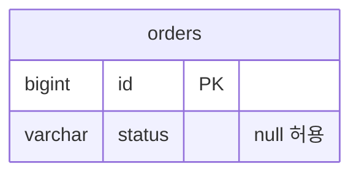
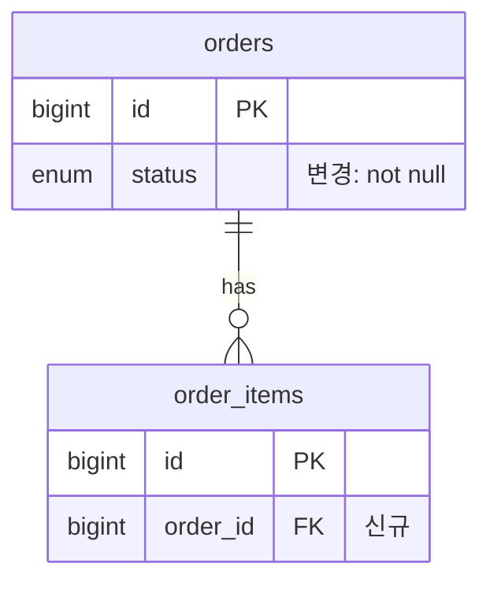

# report — 영향 유형별 상세 (ERD 차이 · 화면 전후 비교 · 신규 화면 설명서)

[SKILL.md 의 C 절](../SKILL.md#c-영향-유형별-상세--db--화면)이 "붙일 절" 로 고른 것만 읽는다.
절 제목에 번호를 붙이지 않는 규칙, 문서 자리는 C 절의 「형식과 자리」를 따른다.

## ERD 차이

**코드에서 읽는다. 기억이나 추측으로 그리지 않는다.** base 와 HEAD 의 스키마 정의를
각각 읽어(`git show <base>:<경로>`) 비교한다. 마이그레이션만 있고 스키마 정의가
없으면 마이그레이션에서 재구성했다고 적는다.

**변경 요약표**

| 테이블 | 컬럼 | 구분 | 기존 | 변경 후 | 기존 행 처리 |
| --- | --- | --- | --- | --- | --- |
| `orders` | `status` | 변경 | `varchar(20)` null 허용 | `enum(...)` not null, 기본 `pending` | null 행 → `pending` 백필 (마이그레이션 `0042`) |
| `order_items` | — | 신규 테이블 | — | `order_id` → `orders.id` FK | 해당 없음 |
| `users` | `nickname` | 삭제 | `varchar(50)` | — | **데이터 소실** — 백업 여부 명시 |

구분은 신규·변경·삭제·이름 변경·인덱스·제약(FK·unique·not null) 중 하나.
**삭제·타입 축소·not null 추가는 기존 행이 어떻게 되는지 반드시 적는다.**

**ERD 전후** — 바뀐 테이블과 **FK 로 바로 닿는 테이블만** 그린다. 전체 스키마를
그리면 차이가 묻힌다. 텍스트 다이어그램(Mermaid `erDiagram` 등)으로 base·HEAD 두 장을
나란히 두고, 바뀐 컬럼에 표시를 단다.

````markdown
#### 변경 전 (base `a1b2c3d`)

#### 변경 후 (HEAD `e4f5g6h`)

````

**함께 적는 것** — 마이그레이션 파일 경로, 되돌리기(down) 가능 여부, 이 컬럼을
읽고 쓰는 코드(grep 결과: API·쿼리·화면), 운영 DB 반영 여부(반영 안 했으면 "안 함").

## 화면 전후 비교

**변경 전 화면이 없으면 비교가 아니다.** 변경 전 캡처는 `/check` 가 착수 시점에 남긴
것을 쓴다. 없으면 base 를 별도 작업 공간(워크트리)으로 꺼내 띄워 **같은 경로·같은
데이터·같은 창 크기**로 찍는다. 그래도 못 찍으면(스키마가 달라 base 가 안 뜨는 등)
"변경 전 캡처 없음 — 이유" 를 적는다. **그리거나 지어내지 않는다.**

화면마다:

| 화면 | 변경 전 | 변경 후 |
| --- | --- | --- |
| 주문 목록 `/orders` |  |  |

| # | 위치 | 기존 | 변경 후 | 이유 |
| --- | --- | --- | --- | --- |
| 1 | 상단 필터 | 기간 필터 없음 | 기간 선택(시작·끝) 추가 | 요청: 월별 조회 |
| 2 | 목록 상태 열 | 영문 코드(`pending`) | 한글 배지(대기) | 상태 enum 변경 |

- 변경 후 캡처에 **번호 표시**(#1, #2 …)를 달아 표의 번호와 맞춘다. 표시를 못 달면
  표의 "위치" 를 화면 영역 이름으로 정확히 적는다
- 상태가 여럿인 화면(빈 목록·오류·권한 없음)은 바뀐 상태만 추가로 찍는다
- 반응형이 바뀌었으면 모바일 폭도 한 쌍 찍는다

## 신규 화면 설명서

새 화면은 비교 대상이 없으니 **처음 쓰는 사람이 이것만 보고 쓸 수 있게** 적는다.

```markdown
### <화면 이름>
- 목적: <누가 무엇을 하려고 쓰나, 한 문장>
- 진입: <URL> · <메뉴 경로 / 어느 버튼에서 오나>
- 권한: <볼 수 있는 역할, 없으면 어떻게 되나>

   ← 영역마다 번호 표시

| # | 영역 | 설명 |
| --- | --- | --- |
| 1 | 검색 바 | 주문번호·고객명으로 부분 일치 검색 |

#### 입력 항목
| 항목 | 필수 | 형식·검증 | 설명 |
| --- | --- | --- | --- |

#### 동작
| 버튼·행동 | 결과 | 호출 API | 바뀌는 데이터 |
| --- | --- | --- | --- |

#### 상태별 화면
빈 상태 · 로딩 · 오류 · 권한 없음 — 실제로 찍은 것만 싣는다

#### 연결
- API: `GET /api/orders` …   - 테이블: `orders`, `order_items` (ERD 차이 절 참고)
```
